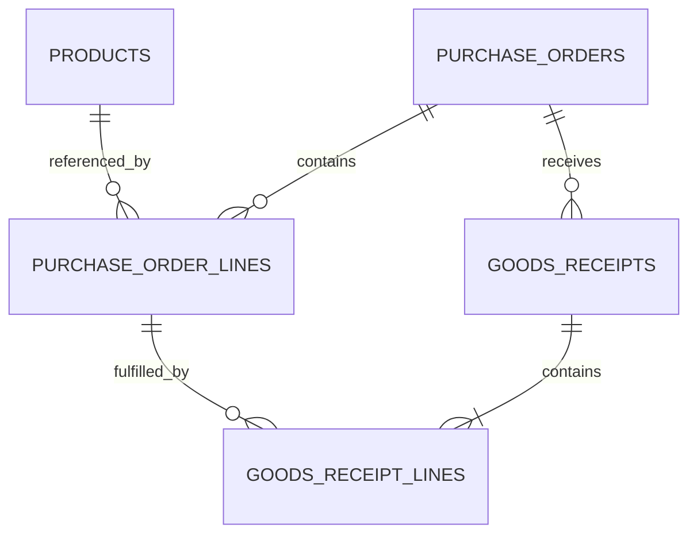

# Database and persistence baseline

Checkpoint: 16 October 2026. Suggested repository location: `docs/database-design.md`.

This document describes the Ruby implementation supplied in the project conversation, including the latest receipt persistence extension. It is not an inspection of the local WSL repository, and the latest receipt test results have not been supplied. Treat it as a design checkpoint to compare with the implemented code, not a certification that every test passes.

## 1. Scope and responsibilities

The application currently models products, purchase orders, their lines, and partial goods receipts. Ruby domain objects enforce business rules. SQLite stores their values across program runs. Repository classes translate between the two representations using explicit SQL; there is no ORM.

GraphQL is planned as the client-facing API. It will call application operations that use the domain model and repositories. It will not replace the database or bypass receiving rules.

| Component | Current role |
| --- | --- |
| `Product` | Validates and exposes an ID, SKU, and name. |
| `PurchaseOrderLine` | Holds a line ID, product ID, and positive integer quantity. |
| `PurchaseOrder` | Controls draft/confirmed status, unique lines, and receipt acceptance. Internally indexes lines by ID. |
| `GoodsReceipt` / `GoodsReceiptLine` | Represent a fixed delivery and quantities against order lines. |
| `db/schema.sql` | Creates five tables and their constraints. |
| `SQLiteProductRepository` | Inserts and finds products. |
| `SQLitePurchaseOrderRepository` | Inserts orders with lines, reconstructs orders with receipts, and records new receipts transactionally. |
| Caller/script/test | Opens, configures, and closes the database connection. |

Current scope is one company, one warehouse concept, and whole-unit quantities. There is no warehouse table, supplier table, pricing, accounting, stock ledger, external integration, or GraphQL schema yet. Received quantity is not a complete inventory balance.

## 2. Relationships



The nonempty receipt relationship expresses a domain rule. Foreign keys alone do not ensure that a receipt has at least one line.

A product describes a type of item. An order line records intent to buy it. A receipt line records a delivered quantity against that particular order line. Several receipts may fulfil the same line over time.

## 3. Consolidated schema

The following combines the schema fragments supplied so far. All tables use `IF NOT EXISTS`; it creates missing tables but does not migrate existing tables.

```sql
CREATE TABLE IF NOT EXISTS products (
  id TEXT NOT NULL PRIMARY KEY,
  sku TEXT NOT NULL UNIQUE,
  name TEXT NOT NULL
);

CREATE TABLE IF NOT EXISTS purchase_orders (
  id TEXT NOT NULL PRIMARY KEY,
  supplier_id TEXT NOT NULL,
  status TEXT NOT NULL CHECK (status IN ('draft', 'confirmed'))
);

CREATE TABLE IF NOT EXISTS purchase_order_lines (
  purchase_order_id TEXT NOT NULL,
  id TEXT NOT NULL,
  product_id TEXT NOT NULL,
  ordered_quantity INTEGER NOT NULL
    CHECK (
      typeof(ordered_quantity) = 'integer'
      AND ordered_quantity > 0
    ),
  position INTEGER NOT NULL CHECK (position >= 0),

  PRIMARY KEY (purchase_order_id, id),
  UNIQUE (purchase_order_id, product_id),
  UNIQUE (purchase_order_id, position),

  FOREIGN KEY (purchase_order_id) REFERENCES purchase_orders(id),
  FOREIGN KEY (product_id) REFERENCES products(id)
);

CREATE TABLE IF NOT EXISTS goods_receipts (
  purchase_order_id TEXT NOT NULL,
  id TEXT NOT NULL,

  PRIMARY KEY (purchase_order_id, id),
  FOREIGN KEY (purchase_order_id) REFERENCES purchase_orders(id)
);

CREATE TABLE IF NOT EXISTS goods_receipt_lines (
  purchase_order_id TEXT NOT NULL,
  receipt_id TEXT NOT NULL,
  purchase_order_line_id TEXT NOT NULL,
  received_quantity INTEGER NOT NULL
    CHECK (
      typeof(received_quantity) = 'integer'
      AND received_quantity > 0
    ),
  position INTEGER NOT NULL CHECK (position >= 0),

  PRIMARY KEY (
    purchase_order_id,
    receipt_id,
    purchase_order_line_id
  ),
  UNIQUE (purchase_order_id, receipt_id, position),

  FOREIGN KEY (purchase_order_id, receipt_id)
    REFERENCES goods_receipts(purchase_order_id, id),
  FOREIGN KEY (purchase_order_id, purchase_order_line_id)
    REFERENCES purchase_order_lines(purchase_order_id, id)
);
```

### Identity and constraints

- Product IDs and order IDs are unique across their respective tables. IDs are supplied by the caller; no generator exists yet.
- A line is identified by `(purchase_order_id, id)`. The same line ID can exist on different orders.
- A receipt is identified by `(purchase_order_id, id)`. Receipt IDs are not globally unique.
- A receipt line uses the order, receipt, and order-line IDs together as its identity. It has no independent ID yet.
- `UNIQUE (purchase_order_id, product_id)` implements the current rule that a product appears only once per order.
- The two composite foreign keys on receipt lines prevent linking a receipt from one order to a line belonging to another order.
- Positions preserve line ordering through `ORDER BY position`. They must be nonnegative and unique within the parent, but the schema does not enforce contiguous positions.
- `supplier_id` is currently only non-null text. No supplier record is checked.
- SKU uniqueness currently uses the default text comparison: we have not implemented a case-insensitive SKU policy.
- No cascading delete actions are configured. There is no delete API; referenced parent deletion normally fails with foreign-key enforcement enabled.

SQLite applies column affinity before checks. The quantity constraints check the stored value's integer type and positivity, not the original Ruby input type. A direct SQL input that can be converted to an integer may pass. The domain constructor is stricter: it requires an actual Ruby `Integer` before storage.

`NOT NULL` rejects missing values, not empty or whitespace-only strings. Domain validation strips surrounding whitespace and rejects blanks. These are not STRICT tables and do not enforce every Ruby input rule.

## 4. Connection lifecycle and initialization

The caller follows this order:

```ruby
database = SQLite3::Database.new(database_path)

begin
  database.results_as_hash = true
  database.execute("PRAGMA foreign_keys = ON")
  database.execute_batch(File.read(schema_path))

  # Construct repositories and perform operations here.
ensure
  database.close
end
```

Opening a file-backed database opens or creates the database file; the parent directory must exist. `results_as_hash` makes rows accessible by column name, which the repositories expect. Foreign-key enforcement must be enabled on each connection before starting transactions. The repositories currently rely on callers to configure this correctly.

`execute_batch` creates the tables from the schema file. Repository construction itself neither creates tables nor configures the connection. Repositories borrow a connection and do not close it.

Tests use `SQLite3::Database.new(":memory:")`. Each test's connection has its own temporary database. Closing it discards the data. This is real SQLite, not a mock, but does not by itself test durability across process restarts.

## 5. Repository method contracts

| Method | Success | Absence or invalid operation |
| --- | --- | --- |
| Product repository `add(product)` | Inserts one row; returns the input product. | Wrong object type raises `ArgumentError`; duplicate ID/SKU raises `SQLite3::ConstraintException`. |
| Product repository `find(id)` | Returns a new `Product` with stored values. | Missing ID returns `nil`. |
| Order repository `add(order)` | Inserts order and all lines together; returns the input order. | Rejects wrong object type or an order already containing receipts; SQL errors roll back inserts. |
| Order repository `find(id)` | Builds a new order, lines, status, and receipts. | Missing ID returns `nil`; inconsistent stored state can raise during reconstruction. |
| Order repository `record_receipt(order_id, receipt)` | Validates against freshly loaded records, saves the delivery, returns the updated order. | Missing order or invalid receipt raises; failed SQL rolls back the new delivery. |

`add` is insert-only. It is not an upsert or an update. Changing a Ruby object after saving does not change its database row. There is currently no persistence operation for confirming a previously saved draft, editing its lines, or cancelling an order. To save a confirmed order in this checkpoint, confirm it in memory before its initial insertion.

SQL placeholders (`?`) bind values separately from SQL text. They handle quoting and prevent those values from being interpreted as SQL syntax. They do not validate business rules or parameterize arbitrary SQL identifiers.

## 6. Saving and loading a product

Saving extracts `id`, `sku`, and `name` and binds them into an INSERT. Loading selects those columns and calls `Product.new` with the returned values.

The database stores values, not Ruby object identities, methods, frozen state, or class instances. The constructor reestablishes validation and frozen strings on each load. The loaded object therefore has the same business identity but is a different Ruby object (`refute_same` in the test).

An individual product INSERT is atomic without an explicit multi-statement transaction. A second insertion with an existing ID or SKU fails rather than replacing the row.

## 7. Inserting an order atomically

The repository rejects orders containing receipts before writing. Then it opens a transaction, inserts the order header, and inserts each line with its position. It returns only after the transaction commits.

Example failure:

1. Insert order header: succeeds.
2. Insert first line referencing an existing product: succeeds.
3. Insert second line referencing a missing product: foreign-key violation.
4. The exception escapes the transaction block.
5. The driver rolls back the header and first line, then propagates the exception.

Previously committed products remain. Rollback affects database changes made in this transaction, not unrelated rows or arbitrary Ruby object mutations.

## 8. Reconstructing an order

`find` performs these operations:

1. Select the header by order ID; return `nil` if absent.
2. Construct a draft `PurchaseOrder` with the stored ID and supplier ID.
3. Select its lines in position order.
4. Construct each `PurchaseOrderLine` and call `order.add_line`.
5. If the stored status is confirmed, call `order.confirm!`.
6. Select receipt headers in ID order.
7. Select each receipt's lines in position order and construct receipt objects.
8. Call the in-memory `order.record_receipt` for each reconstructed receipt.
9. Return the reconstructed order.

This reuses domain rules to detect inconsistent saved data. It is not sending commands to external systems: the domain methods currently only inspect/change in-memory state.

If these methods later emit notifications, timestamps, integration requests, or events, reconstruction must be separated from business actions. Merely reading an order must never repeat its external effects.

Receipt ID ordering is deterministic but is not delivery chronology. No receipt timestamps currently exist. This matters before building historical reports or chronology-dependent rules.

## 9. Recording a persistent receipt

The repository method and the domain method have different responsibilities:

| Method | Effect |
| --- | --- |
| `order.record_receipt(receipt)` | Validates against that in-memory order and appends to its local array. Does not save. |
| `repository.record_receipt(order_id, receipt)` | Starts a database transaction, loads current state, invokes domain validation, and inserts records. |

The repository uses `transaction(:immediate)`:

1. Acquire SQLite's write reservation before reading the order.
2. Load the order and its previously persisted receipts using the same connection.
3. Validate status, order identity, duplicate receipt ID, known line references, and outstanding quantities.
4. Insert the receipt header.
5. Insert every receipt line.
6. Commit and return the updated order.

All lines pass domain validation before any receipt INSERT. The database transaction additionally protects against later SQL failures.

The write reservation prevents another writer from changing the stored receiving state between this operation's read and write. It does not provide unlimited concurrency: another connection may block or receive `SQLite3::BusyException`, depending on timeout settings. No busy retry policy is implemented. SQLite serializes writers at the database level rather than providing a per-order write lock.

This protects this operation's check-and-write path. Direct SQL that bypasses domain validation can still insert cumulative over-delivery; the schema has no aggregate quantity constraint.

If a database write fails after domain validation, the local order has been changed in memory, but that object is internal to the repository call and is not returned on failure. Database rollback does not itself undo Ruby mutations.

Duplicate receipt recording currently raises an error. It prevents double counting but is not yet a successful idempotent retry API. Recognizing an identical retry versus conflicting content under the same ID is future work.

## 10. Quantity example

| Record | Stored quantity |
| --- | --- |
| Order `order-001`, line `line-001`, product `product-001` | Ordered: 10 |
| Receipt `receipt-001`, same order line | Received: 6 |
| Receipt `receipt-002`, same order line | Received: 4 |

There is no stored `received_total` or `outstanding_total` column.

```text
received = sum of matching receipt-line quantities = 6 + 4 = 10
outstanding = ordered - received = 10 - 10 = 0
```

A further positive receipt is rejected. After only the first receipt, a delivery of five is rejected because only four are outstanding.

Calculating totals avoids maintaining two sources of truth. The current implementation scans receipt lines each time a quantity is requested; it does not yet batch or cache these calculations.

## 11. Where each rule is enforced

| Rule | Domain | Database |
| --- | --- | --- |
| Nonblank text | Yes | NOT NULL only; blanks are not rejected. |
| Positive whole quantity | Ruby Integer check | Stored integer type and positivity check. |
| Unique product ID/SKU across catalogue | No catalogue check | Primary key / UNIQUE. |
| Unique line ID and product within an order | Yes | Composite primary key / UNIQUE. |
| Referenced product exists | Not in line constructor | Foreign key, when enabled. |
| Supplier exists | No | No supplier table yet. |
| Confirmed order is nonempty | Yes | Not enforced by current schema. |
| Only confirmed orders can receive | Yes | Not enforced by current schema. |
| Receipt belongs to the correct order | Yes | Composite relationships enforce stored references. |
| Receipt is nonempty | Yes | Not enforced by current schema. |
| No duplicate order line in a receipt | Yes | Composite primary key. |
| No cumulative over-delivery | Yes | No aggregate constraint. |
| No repeated receipt ID within an order | Yes | Composite primary key. |

Both layers matter. Domain rules provide understandable operations; database constraints protect shared stored relationships. Neither currently implements every rule alone.

## 12. Read consistency and performance limitations

The current `find` loads an order using several SELECT statements: header, lines, receipt headers, and one line query per receipt. For R receipts this is approximately 3 + R queries, even if no receipts exist. It intentionally favors clarity at this stage.

When called from `record_receipt`, these reads occur inside its transaction. A standalone `find` does not establish an explicit shared read transaction across all its SELECTs. As update operations and multiple users are added, we should give reconstruction a consistent read snapshot. We must avoid naively nesting transaction blocks because the current driver API does not support nested transactions through that method.

The schema's primary and unique constraints provide indexes useful for order-scoped lookups. Product-wide searches across order lines may need additional indexes. We have not measured query plans or performance yet.

GraphQL could amplify repeated queries and calculations. Batching or aggregate queries can address that later; adding GraphQL alone will not optimize repository access.

## 13. Tests and evidence

The supplied tests cover product reconstruction, unknown IDs, duplicate ID/SKU constraints, apostrophes in bound values, order status and line order, rollback when a later order line fails, receipt reconstruction, over-delivery, duplicate receipts, and receipt rollback using a test-only trigger that rejects a line INSERT.

Each test opens an isolated in-memory SQLite database. A trigger used in one test does not affect other connections or the file-backed demo.

The product demo separately saves and loads across process runs. An equivalent full-order restart demonstration remains to be added. Concurrency, crash recovery, busy retries, migrations, and standalone read snapshots are not covered by the current supplied tests.

Run the complete suite:

```bash
bundle exec ruby -Itest test/all_test.rb
```

No passing result for the latest receipt persistence extension is asserted in this document.

## 14. File map and next work

```text
db/schema.sql
lib/procurement/product.rb
lib/procurement/purchase_order_line.rb
lib/procurement/purchase_order.rb
lib/procurement/goods_receipt_line.rb
lib/procurement/goods_receipt.rb
lib/procurement/persistence/sqlite_product_repository.rb
lib/procurement/persistence/sqlite_purchase_order_repository.rb
test/sqlite_product_repository_test.rb
test/sqlite_purchase_order_repository_test.rb
persistence_demo.rb
```

Commit schema, repository source, tests, and documentation. Local database files and SQLite auxiliary files are excluded by the current `.gitignore` rules. Backup and migration procedures are not implemented yet.

Next priorities:

1. Verify the receipt tests and demonstrate full-order persistence across runs.
2. Consolidate connection setup so every connection uses the same settings.
3. Define persistent lifecycle operations, including confirming an existing draft.
4. Add suppliers and an explicit migration mechanism as the schema evolves.
5. Address consistent reconstruction and error translation for an application interface.
6. Introduce stock movements and pending integration deliveries with appropriate shared transactions.
7. Expose application operations through GraphQL.

The immediate design is a learning baseline, not a finished ERP database. Its main guarantees are valid domain operations, relational identity, and atomic local writes through the supplied repositories.

## Reference

- SQLite Ruby driver API, including transaction block semantics: https://sparklemotion.github.io/sqlite3-ruby/SQLite3/Database.html
- Driver README and parameter binding examples: https://github.com/sparklemotion/sqlite3-ruby

## Suggested README addition

Append the following after placing this document at `docs/database-design.md`:

```markdown
## Database and persistence

The application uses SQLite with explicit Ruby repositories. Products,
purchase orders, order lines, and partial goods receipts are stored in
five related tables. Orders and their lines are inserted atomically;
receipt recording reloads the saved order and validates quantities inside
a write transaction. Received and outstanding quantities are calculated
from receipt records.

This baseline supports insertion and retrieval, plus adding receipts to
stored confirmed orders. Updating a stored draft to confirmed, supplier
storage, stock movements, migrations, and GraphQL are still planned.

See [Database design and persistence](docs/database-design.md) for the
schema, constraints, operation sequences, and current limitations.

Run all tests with `bundle exec ruby -Itest test/all_test.rb`.
```
